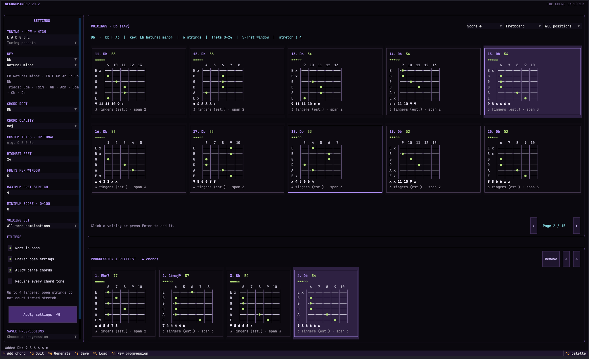

# Neckromancer

A terminal app for exploring guitar chord voicings and building progressions.
Supports custom tunings, chord tones, and key filtering.


## Run

Requires Python 3.10+.

```sh
python3 -m venv .venv
source .venv/bin/activate
python -m pip install -r requirements.txt
python neckromancer.py
```

## Use

Choose a chord and tuning in the sidebar, then apply the settings. Tuning notes
run from lowest string to highest. The default voicing set is **All tone
combinations**; common guitar shapes and strummable shapes are also available.

Click a voicing or press Enter on it to add it to a progression. Save and load
progressions as JSON files in `progressions/`.

| Shortcut | Action |
| --- | --- |
| Ctrl+G | Apply settings |
| PageUp / PageDown | Browse results |
| Ctrl+S / Ctrl+L | Save / load progression |
| Ctrl+N | New progression |
| Delete | Remove selected progression chord |
| Ctrl+Left / Ctrl+Right | Reorder selected chord |
| Ctrl+Q | Quit |

Scores and finger counts are estimates.

For a starting chord, a custom tuning, or plain terminal output:

```sh
python neckromancer.py --root E --quality min7
python neckromancer.py --tuning 'B E A D G B E'
python neckromancer.py --cli --root C --quality maj --limit 10
python neckromancer.py --help
```

## Tests

```sh
python -m unittest
```
